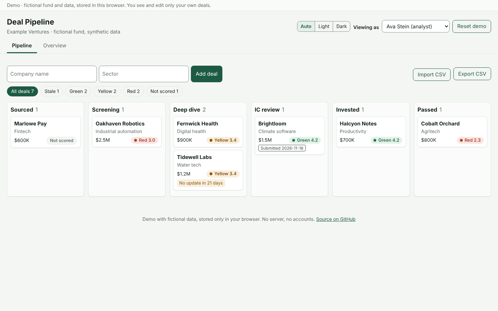
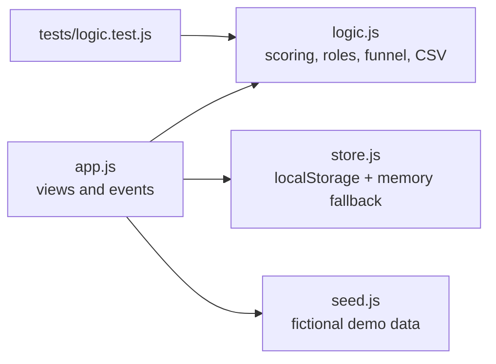

# VC Deal Pipeline

[](https://github.com/aradyaacovi/vc-deal-pipeline/actions/workflows/test.yml)
[](https://aradyaacovi.github.io/vc-deal-pipeline/)
[](LICENSE)


**A deal-flow tracker for a small VC team: a pipeline board, a weighted traffic-light evaluation, a read-only manager overview and CSV import.**

Live demo: **[aradyaacovi.github.io/vc-deal-pipeline](https://aradyaacovi.github.io/vc-deal-pipeline/)**. It runs on a fictional fund ("Example Ventures") with invented companies. Data stays in your browser.



| Evaluation | Manager overview |
| --- | --- |
|  |  |

## The problem

Early-stage investing teams track deals in spreadsheets. Three things go wrong: nobody can see at a glance which deals have gone quiet, evaluations are inconsistent between analysts, and a manager has to ask around to learn where the pipeline stands. This tool keeps the process small and explicit: every deal sits in one stage, is scored against the same rubric, and shows up in an overview the manager can read without editing anything.

I built it from my experience mentoring early-stage startups through a university VC fund's investment process. The product decisions are mine; the data and everything in this repository are generic and fictional.

## What it does

- **Pipeline board.** Six stages from Sourced to Invested or Passed. Each card shows the ask, the traffic light, and a stale warning.
- **Weighted evaluation.** Five criteria (team 30%, market 25%, product 20%, traction 15%, terms and fit 10%), each rated 1 to 5. Green from 3.8, yellow from 3.0. **A 1 on any criterion forces red**, so a fatal flaw is not averaged away by strong scores elsewhere. Partial ratings are allowed and marked as partial.
- **Per-deal checklist.** Fifteen process steps in four phases (before the first meeting, first meeting, after, due diligence) with progress shown on the deal and in the overview. The steps are generic ones I wrote for the demo; a team would swap in its own.
- **Submission to the investment committee.** "Submit to IC" is blocked until the evaluation is complete and not red, at least 10 checklist steps are done, the notes have substance and the ask is entered. The blockers are listed, and a successful submission moves the deal to IC review and records the date, light and score.
- **Draft IC memo.** One click builds a markdown memo from the deal record (summary, rubric table, strengths, risks and gaps, process status, a recommendation that follows the traffic light), downloadable as `.md`. Also a template, not an AI call.
- **Stage history.** Every stage change is recorded, and each deal shows its timeline and days in the current stage.
- **Board filters.** Stale, green, yellow, red or not scored, with counts.
- **Meeting prep.** One click drafts opening points and questions from the deal's scores and notes. It is a deterministic template, with no AI call: the weakest or unrated criteria get the most questions, so the meeting is spent where the evaluation is least certain.
- **Roles.** Analysts see and edit only their own deals. The manager sees every deal, read-only.
- **Manager overview.** Workload by analyst (active, stale, submitted, average score and checklist, active ask), active deals, average score, green deals, stale deals, total active ask, a funnel with stage-to-stage conversion, and a table of all deals with checklist progress.
- **Stale detection.** An active deal with no update for more than 14 days is flagged.
- **CSV import and export.** Import validates every row and reports problems by file line number. Valid rows can still be imported when others fail. Duplicates and unknown stages are caught.
- **Calm interface.** Quiet surfaces, with colour kept for what needs action: four exception tiles (red light, gone quiet, not scored, ready for IC) double as table filters, search narrows the list, and a deal opens in a side panel while the list stays in view. Light, dark and auto themes.
- **Accessible by default.** Keyboard operable, labelled controls, status messages announced, light and dark themes, and traffic lights that carry a word as well as a colour.

## How it is built



- **Pure logic, separate from the screen.** Scoring, permissions, staleness, the funnel and CSV validation live in [`js/logic.js`](js/logic.js) with no DOM or storage, so they are fully unit-tested. The UI only renders what the logic returns.
- **No framework, no build step, no dependencies.** Plain ES modules. Open it from any static host.
- **Safe rendering.** Everything from imported files is inserted as text nodes, never as HTML, so a hostile CSV cannot inject markup.
- **Reproducible demo.** `?today=2026-11-20&as=dana&view=overview` pins the date, the user and the view, which is how the screenshots above were taken.

## Honest limits

This is a front-end demo. There is **no backend and no authentication**: the role rules are enforced in the UI layer to show the model, and they are not a security boundary. A real deployment would enforce them on the server and store data in a database. Scores and thresholds are illustrative and meant to be edited in [`js/logic.js`](js/logic.js). The reasoning behind them is in [`docs/DECISIONS.md`](docs/DECISIONS.md).

## Run it

```bash
git clone https://github.com/aradyaacovi/vc-deal-pipeline.git
cd vc-deal-pipeline
npm start        # http://localhost:8080
npm test         # 25 unit tests, Node 20+, no install needed
```

## Tests

The suite covers the rubric weights, light thresholds and the fatal-flaw rule, partial scoring, analyst isolation and manager read-only access, stale detection at the 14-day boundary, funnel counts and conversion, passing and reopening a deal, CSV parsing (quotes, embedded newlines, CRLF), CSV round-trip, import validation with line numbers, checklist progress, and meeting-prep question targeting. CI runs it on every push and deploys the demo to GitHub Pages.

## How this was built

Designed and directed by me, with Claude Code as a pair programmer for implementation. The scoring rules, the roles model and the fatal-flaw rule are product decisions I made; the code was written with AI assistance and verified with the tests above.
