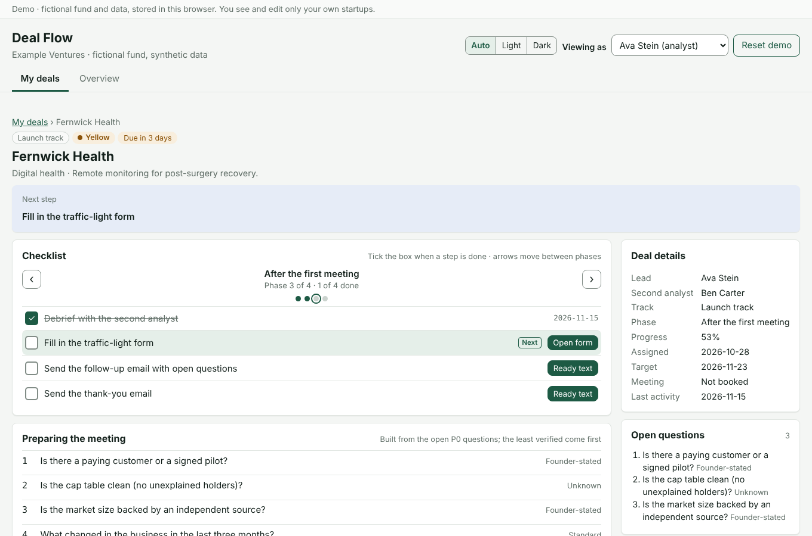
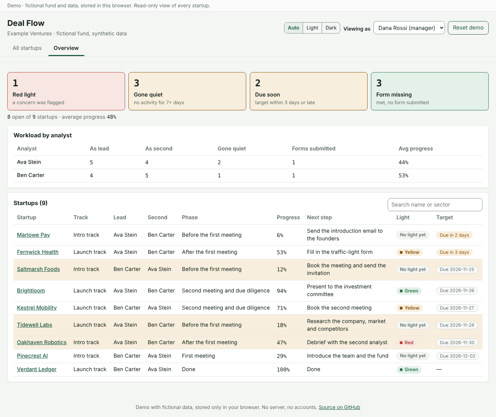
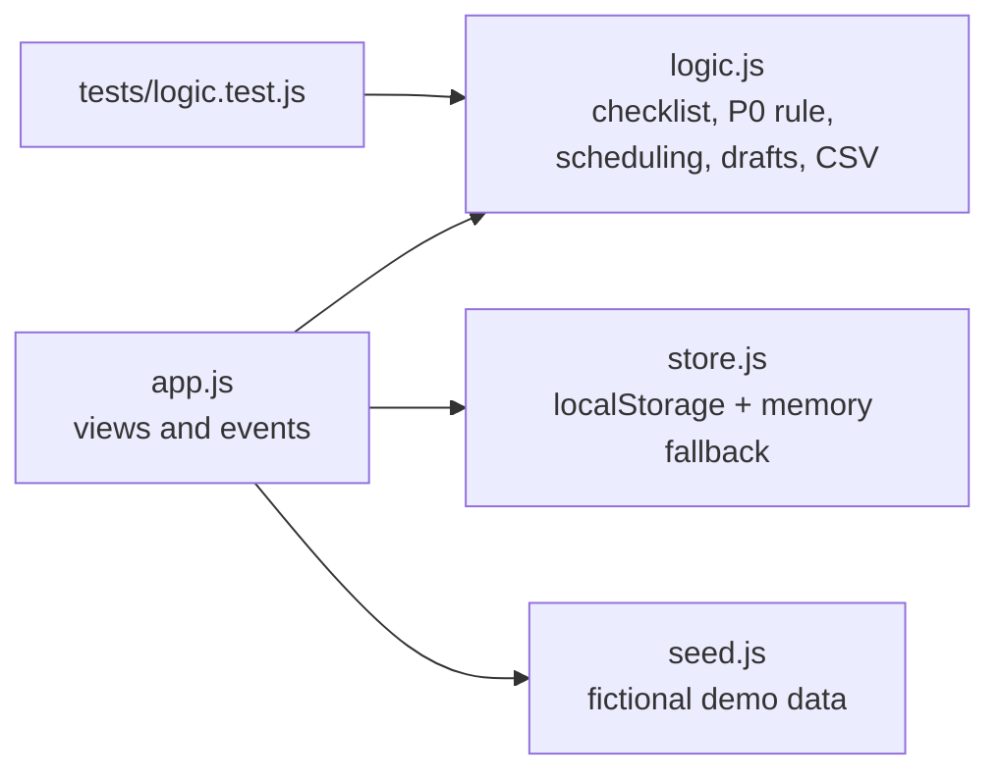

# VC Deal Pipeline

[](https://github.com/aradyaacovi/vc-deal-pipeline/actions/workflows/test.yml)

[](LICENSE)


**An analyst workflow tool for a student VC fund: every startup moves through the same checklist, each step has a ready-made text, the analyst fills in a traffic-light form, meetings are booked from shared availability, and a manager sees exceptions without editing anything.**

This is a fictional demo: a made-up fund ("Example Ventures") with invented companies. Run it locally as described below; data stays in your browser.


| Deal page | Manager overview |
| --- | --- |
|  |  |

## The problem

In a student VC fund, analysts guide early-stage startups from a first intro to the investment committee. Without a shared process, steps get skipped, startups go quiet, forms arrive incomplete, and a manager has to ask around to learn the state of things. This tool is a generic version of the workflow I built and use: one process for every startup, drafts instead of blank pages, and a manager view made of exceptions.

The product decisions come from my own work mentoring startups in a university fund. Everything in this repository is generic and fictional.

## The flow

1. **Assignment.** Each startup has a lead analyst and a second analyst, and a track (intro or launch). Analysts see and edit only their own startups.
2. **Four-phase checklist.** Before the first meeting, first meeting, after the first meeting, second meeting and due diligence. A stepper moves between phases; the next step is always shown.
3. **A ready text for every step.** Introduction email, meeting prep, follow-up, thanks, document request, memo outline. Fixed templates filled from the record, editable, copy with one click. No AI call.
4. **Scheduling from availability.** Analysts mark free hours. The tool proposes three times where the lead and at least one peer are free and nothing else is booked, drafts the email, and books the slot the founders choose. The slot is re-checked at booking, so a double booking is rejected.
5. **Preparing the meeting.** Questions come from the open P0 items, least verified first, plus three standard ones.
6. **Traffic-light form.** Five P0 questions, each marked unknown, founder-stated, verified or concern, with a source. A rule suggests a light (any concern is red, at least 75% verified is green, otherwise yellow); the analyst decides. The form can be proposed from the record, is blocked from submission until complete, and submitting ticks the checklist and logs the activity.
7. **Founder information stays labelled.** What founders told us is shown on its own tab as unverified, apart from our own findings.
8. **Document room and activity.** What was requested, what arrived, and a timeline of every change.
9. **Manager overview.** Read-only. Four exception tiles (red light, gone quiet, due soon, form missing) double as filters, plus search, a startups table and analyst workload.

Also: CSV import and export (validated, with line numbers, formula-safe), light, dark and auto themes, and traffic lights that carry a word as well as a colour.

## How it is built



- **Pure logic, separate from the screen.** The checklist, P0 rule, scheduling, drafts, exceptions and CSV validation live in [`js/logic.js`](js/logic.js) with no DOM or storage, and are unit-tested.
- **No framework, no build step, no dependencies.** Plain ES modules on any static host.
- **Safe rendering.** Imported text is inserted as text nodes, never HTML.
- **Reproducible demo.** `?today=2026-11-20&as=ava&view=deal&deal=s1` pins date, user and view, which is how the screenshots were taken.

## Honest limits

This is a front-end demo. There is **no backend and no authentication**: roles are enforced in the UI layer to show the model, not as a security boundary. A real deployment enforces them on the server. Checklist steps, P0 questions and thresholds are generic and meant to be edited in [`js/logic.js`](js/logic.js). The reasoning is in [`docs/DECISIONS.md`](docs/DECISIONS.md).

## Run it

```bash
git clone https://github.com/aradyaacovi/vc-deal-pipeline.git
cd vc-deal-pipeline
npm start        # http://localhost:8080
npm test         # 14 unit tests, Node 20+, no install needed
```

## Tests

The suite covers the checklist and phase progress, activity logging, analyst isolation and manager read-only access, quiet and due-soon detection, the P0 light rule, form blockers, open questions, availability matching with a double-booking rejection, drafts, exception tiles, workload counts, and CSV parsing, validation, export and formula safety. CI runs it on every push and deploys the demo to GitHub Pages.

## How this was built

Designed and directed by me, with Claude Code as a pair programmer for implementation. The process, the P0 light rule and the roles model are product decisions I made; the code was written with AI assistance and verified with the tests above.
